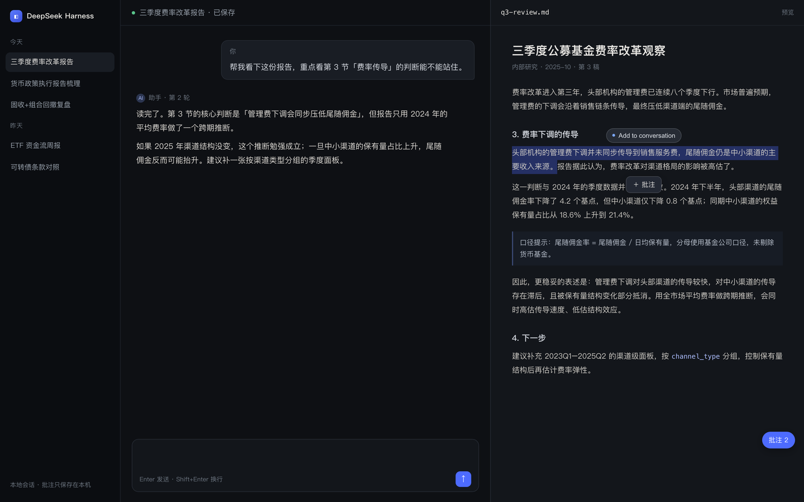
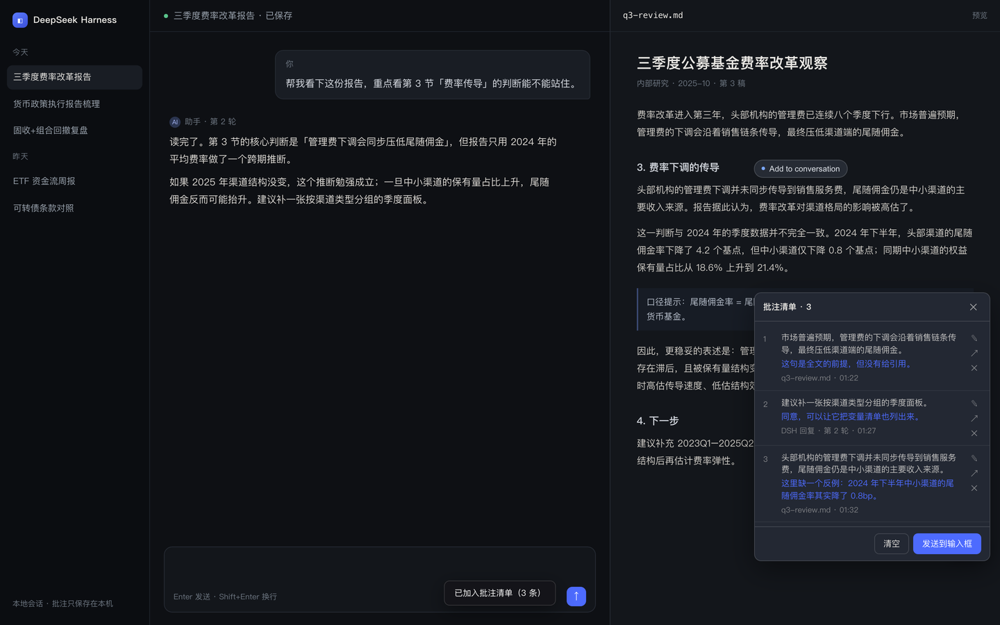

# dsh-margin-notes · DSH 页边批注插件

**DSH 页边批注插件**：在文档预览或助手回复里划词，写一句批注；攒成一批后，收进输入框里的一个内联批注块，发送时才展开成完整文本。

面向 [DeepSeek Harness](https://github.com/deepseek-ai/deepseek-harness)（DSH）的 Web GUI / 桌面 App。客户端插件，无运行时依赖，不联网，不接管文档渲染。

MIT · DSH 0.2.x · 38 项单测 + 74 项浏览器回归



## 一句话说清

读长文档或长回复时，人往往一次想改很多处：这里要补引用、那句结论太强、这个数字口径不对。DSH 自带的「引用」一次只能带一条原文，逐条发送既慢又容易漏。

dsh-margin-notes 把「划词 → 写批注 → 继续读」变成连续动作：批注先进入右下角的本地队列，读完再点「发送到输入框」，整批批注先收成输入框里的一个「批注块」chip，不占正文位置；你可以继续在同一个输入框里写别的指令，回车发送时 chip 才展开成带编号的结构化块，模型按 `Annotation 1 / 2 / 3` 逐条回应。

批注只存在本机 `localStorage`，按会话隔离；不点发送，不会进入对话。

## 适合谁，不适合谁

| 适合 | 不适合 |
| --- | --- |
| 逐段审阅报告、论文、合同，想一次提多条修改意见 | 想要正文内联高亮、评论线程、多人协作 |
| 读助手的长回复，想集中指出几处问题再追问 | 需要云端同步、跨设备共享批注 |
| 边读边记「待核实 / 待补数据」，不想打断阅读节奏 | 扫描版 PDF、canvas 渲染的预览（没有可选中文本） |
| 希望批注进入对话时仍保留原文上下文 | 想让它自动替你把批注发出去（它只写草稿） |

## 它和「选中后引用」有什么不同

| 对比项 | DSH 自带「引用」 | dsh-margin-notes |
| --- | --- | --- |
| 一次带一条原文 | 是 | 是 |
| 给每条写批注文字 | 引用后自己补，逐条操作 | 每条独立批注，可留空只标位置 |
| 跨文档 / 助手回复汇总 | 否 | 是，同一队列，逐条标来源 |
| 一次写入输入框 | 否 | 是，结构化块 + 编号 |
| 发送前统一编辑 | 否 | 清单里逐条改、定位、删除 |
| 数据位置 | 会话 | 本机 `localStorage`，按会话隔离 |

两者可以共存：选中文字时，宿主自己的按钮在上方，本插件的「＋ 批注」在下方，互不遮挡。

## 功能

- **文档与回复都能批注**：右侧栏预览、全屏预览、宿主原生预览里的文档面板；对话里的助手回复（`assistant-step` / `turn-process`）。用户消息、工具卡片、输入框不触发。
- **批量队列**：右下角徽标显示条数；点开是批注清单，可逐条 `✎` 编辑、`↗` 定位回原文、`✕` 删除，或整体清空。
- **输入框里的批注块**：整批收成一个内联 chip（显示「批注块」），不占正文位置；发送时由插件 codec 展开成带编号的结构化块。草稿里原有的文字保持原样，可以继续在同一个输入框里写指令。
- **合并而不是堆叠**：草稿里已经有本插件的批注块时，新一批会合并进同一个 chip，不会出现两个块。
- **按会话持久化**：key 为 `dsh-margin-notes:v1:<sessionId>`，切会话各自独立；旧版 `dsh-batch-annotations:v1:` 的数据首次加载时自动迁移。
- **中英双语**：跟随 DSH 界面语言，运行中切换也即时更新徽标、清单与按钮文案。
- **不抢选区、不挡按钮**：发送后聚焦输入框有防抢选区守卫；浮层默认在选区下方，贴视口底边时翻到上方，并避开宿主的 `Add to conversation` 胶囊。
- **可访问性**：浮层、清单、徽标带 `role` / `aria-label`，提示用 `role="status"` 播报；键盘支持 `⌘/Ctrl + Enter` 保存、`Esc` 关闭。
- **HMR 幂等**：重复 `apply()` 会先清理旧实例与残留节点，只保留一套 UI。

## 界面

划词后，选区下方出现「＋ 批注」；上方是 better-sidebar 自带的 `Add to conversation`，两者自动避让：


批注清单把文档与助手回复的批注放在同一个队列，发送前可逐条编辑：



> 截图为本地渲染的界面示意，使用与插件相同的 `lib/client.js` 和假宿主服务，不是真实会话内容。

## 安装

前置：DSH 0.2.x（Web GUI 或桌面 App）。插件是纯客户端 bundle，安装后通常无需重启。

### 方式一：发布包（推荐）

DSH 侧栏「插件」→ 添加插件，填入：

```
https://github.com/mantonlove/dsh-margin-notes/releases/latest/download/dsh-margin-notes.tgz
```

安装器会执行 `inspect → pnpm add → 写入 dsh.profile.bundles`，HMR 生效。

### 方式二：本地软链（开发）

```
link:/absolute/path/to/dsh-margin-notes
```

改 `lib/client.js` 即时生效。安装细节与验证步骤见 [`docs/install-and-verify.md`](docs/install-and-verify.md)。

### 方式三：Git 源

```
github:mantonlove/dsh-margin-notes
```

需要你的 DSH 版本支持 git 安装源；不支持时用方式一。

### 确认是否装上

打开 profile 的 `package.json`，确认：

- `dependencies` 里有 `dsh-margin-notes`；
- `dsh.profile.bundles` 数组里有 `"dsh-margin-notes"`。

然后在文档里选中一段文字，看选区下方是否出现「＋ 批注」。

## 使用

1. 在文档面板或助手回复里**选中文字**，松开鼠标。
2. 点选区下方的 **「＋ 批注」**。
3. 写一句批注（可留空，只标位置），`⌘/Ctrl + Enter` 或「保存」。
4. 继续读、继续选；右下角徽标累计条数。
5. 点徽标打开清单，逐条检查、编辑、定位或删除。
6. 点 **「发送到输入框」**，整批变成输入框里的一个「批注块」chip；可以继续写别的指令，回车时 chip 自动展开成完整文本。

小技巧：

- 清单里双击条目或点 `✎` 可以改批注文字，原文不变；`⌘Enter` 保存，`Esc` 取消。
- `↗` 会回到原文位置并重新选中；它只在当前 DOM 里找，原文已消失时（例如切走了文档）不会跳转。
- 草稿里已经有本插件的批注块时，新批注会合并进同一个 chip；草稿是斜杠命令时不会拼入，避免破坏命令。

## 批注块长什么样

单来源（一个文档，或一轮回复）：

```
【批注 · 请逐条回应】文档：report.md

1. 原文：「头部机构的管理费下调并未同步传导到销售服务费」
   批注：这里需要补一个 2024 年下半年的分组数据

2. 原文：「样本量偏小」
   批注：（无文字，仅标记此段）

请按「Annotation 1：…」逐条回应，不要遗漏。

【批注结束】
```

混合来源（文档 + 助手回复，或多个文档）时，表头不再写单一文档，每条前面标来源：

```
【批注 · 请逐条回应】

1. 来源：DSH 回复 · 第 2 轮
   原文：「这个推断勉强成立」
   批注：判断偏强，缺季度面板

2. 来源：q3-review.md
   原文：「尾随佣金仍是中小渠道的主要收入来源」
   批注：补一条反例

请按「Annotation 1：…」逐条回应，不要遗漏。

【批注结束】
```

草稿里原本有文字时，块在前、原文在后，中间用 `【我的提问】` 分隔。界面语言为英文时，标记和提示会切成英文（`[Annotations — respond one by one]`）。

## 常见问题（FAQ）

### 为什么我选中文字，没有出现「＋ 批注」？

先确认三件事：

1. 选区在**文档预览面板**或**助手回复**里。用户消息、工具调用卡片、输入框里的选区按设计不触发，避免和 DSH 自带的「引用」重复。
2. 是**鼠标拖选**后松开，而不是只在输入框里移动光标。
3. 插件确实在 `dsh.profile.bundles` 里，且页面已重载。

仍不出现时，打开开发者工具看 `window.__dshBatchAnnotationsHost__` 是否存在；不存在说明 bundle 没加载。

### 批注会自己发出去吗？

不会。插件把整批内容作为内联引用 chip 插入草稿（`insertReference`），只在发送时由 codec 展开成完整文本；是否发送、何时发送由你决定。草稿里已有批注块时会合并，不会重复追加。

### 批注存在哪里？会不会上传？

存在当前浏览器的 `localStorage`，key 是 `dsh-margin-notes:v1:<sessionId>`，按会话隔离。插件没有任何网络请求，也不做遥测；清除站点数据会删掉批注，卸载插件不会自动删除。

### 支持 PDF 吗？

取决于预览器是否把文字渲染成可选中的 DOM 文本。文本层 PDF 可以；canvas 渲染的 PDF、以及塞进 iframe 的 HTML 预览不行——跨文档拿不到选区。

### 和 better-sidebar 的 `Add to conversation` 冲突吗？

不冲突。宿主按钮在选区上方，本插件默认在下方；贴视口底边时翻到上方并叠在宿主按钮之上，而不是盖住它。定位前还会扫一遍 `selectionPopup` 和选区附近的 `position: fixed` 浮层做避让。

### 为什么按钮有时候出现在选区上方？

选区贴着视口底边、下方放不下时，浮层会翻到上方；如果上方有宿主胶囊，会继续往上让。滚动或缩放窗口时浮层会收起，避免停在错位的文字上。

### 升级或重装会丢批注吗？

不会。存储 key 带 `v1` 前缀且不随版本变化；旧版 `dsh-batch-annotations:v1:` 的数据会在首次加载时迁移。只有清除浏览器站点数据才会丢。

### 能同时开两个窗口批注同一个会话吗？

不建议。两个窗口各自持有内存队列，保存时以最后写入的为准，另一个窗口不会实时同步。需要并行时，先在一个窗口发送完再开另一个。

### 支持哪些 DSH 版本？

在 DSH 0.2.2-rc.2 上实测；依赖 `sessions`、`conversation`、`locale`、`uiSession` 四个客户端服务，0.2.x 设计目标。更早的版本未验证。

### 会不会影响性能？

事件监听都在 `document` 捕获阶段，选区变化有 80ms 防抖；浮层只创建一个节点，清单按需渲染。没有轮询，也没有 MutationObserver 常驻（仅浮层显示后 900ms 内兜住宿主异步挂载）。

## 兼容性与实现方式

- **只监听选区，不接管渲染**：靠 DOM 锚点识别文档面板与助手回复，不依赖 better-sidebar 的内部实现；侧栏、全屏、原生预览都能用。
- **对话来源**：`[data-chat-flow-kind="assistant-step"]` / `[data-chat-flow-kind="turn-process"]`，轮次取自 `data-chat-turn`；不劫持消息渲染。
- **不写宿主状态**：除输入框草稿与插件自己的本地存储外，不修改会话、消息或文档内容。
- **定位兜底**：若浮层被祖先的 `transform` / `filter` / `contain` 困在错误的 containing block 里，会提升到 top layer（`popover="manual"`）并记录诊断到 `localStorage['dsba:diag']`。
- **服务缺失降级**：找不到会话或输入框时只弹提示，不把异常抛到界面。

## 已知边界

- 不做正文内联高亮，避免与编辑器重渲染冲突；回看用清单里的 `↗`。
- 只处理文档与助手回复，不处理用户消息、工具卡片、输入框。
- 无云端同步、无多人协作、无批注导入导出。
- 划词本身需要鼠标；键盘支持限于浮层内的保存 / 取消。
- 同一浏览器多标签页不实时同步（见 FAQ）。
- 批注块是输入框里的内联 chip；刷新后若草稿仍在，展开文本从 `localStorage` 的 `dsh-margin-notes:chip:v1:<ref>` 恢复（只保留最近 24 个块）。清除站点数据后，旧 chip 无法展开，删掉重发即可。

## 开发与测试

```
npm test                                 # 38 项：契约 12 + 格式 13 + 落点/chip 13
python3 -m http.server 8732              # 在包根目录起服务
open http://127.0.0.1:8732/test/harness.html   # 74 项浏览器回归
```

- `test/contract.test.mjs` 把 App 的加载规则钉成断言：`dsh.client.platform === 'web'`、`exports["./client"]`、注册 id 等于包名、`cordis.patch.yml` 的 insert 行、四个 Cordis 服务名。
- `test/format.test.mjs` / `test/placement.test.mjs` 在 VM 沙箱里直接加载 `lib/client.js`，验证真实产物里的纯函数（块拼装、选区过滤、存储、浮层落点、徽标夹取、chip 投影剪裁与 detect 坐标）。
- `test/harness.html` 用假 `ctx` 和假 DOM 跑全链路：选区 → 浮层 → 弹卡 → 徽标 → 清单（编辑 / Esc）→ 拼块 → 写草稿，并覆盖输入框 chip（插入、合并、刷新后展开、无 `insertReference` 时回退文本）、语言切换、热替换幂等与 `dispose` 清理。
- `assets/demo.html` 是 README 截图的渲染页：真实 `client.js` + 假宿主服务，可本地打开。

设计说明见 [`docs/install-and-verify.md`](docs/install-and-verify.md)。改交互后先跑 harness；它已经抓到过「弹卡引用未赋值导致浮层叠罗汉」「清单先渲染后置位导致空白」「发送后延迟聚焦抢走新选区」三个真实 bug。

## English

**dsh-margin-notes** is a margin-annotation plugin for [DeepSeek Harness](https://github.com/deepseek-ai/deepseek-harness) (DSH). Select text in a document preview or an assistant reply, attach a short note, collect several notes in a local queue, then insert the whole batch into the composer as one structured, numbered block — the model answers each annotation in order.

- Works on document panels and assistant replies; user messages, tool cards and the composer are ignored.
- Batch queue per session, stored in `localStorage` and never uploaded; sending is always manual.
- The whole list can be reviewed, edited, located and deleted before sending.
- Chinese and English UI; follows the host locale at runtime.
- Client-only bundle, no runtime dependencies, no network requests.

Install from the DSH plugin panel with:

```
https://github.com/mantonlove/dsh-margin-notes/releases/latest/download/dsh-margin-notes.tgz
```

Requires DSH 0.2.x. See the Chinese sections above for usage, FAQ and known limits.

## 变更记录

### 0.1.4

- 改进：发送到输入框的整批批注不再铺成一大段文字，而是收成输入框里的一个内联「批注块」chip；发送时由 codec 展开，平时只占一个 token 的位置。
- 改进：同一草稿里再次发送会合并进现有 chip；chip 内容持久化到 `localStorage`，刷新后仍可展开。
- 兼容：没有 `insertReference` 的旧 composer 自动回退为原来的文本块。
- 测试：单测 38 项、浏览器 harness 74 项。

### 0.1.3

- 文档与发布资产：新增插件图标（`assets/icon-180.png`）与两张界面截图，重写 README（安装、用法、FAQ、兼容性、英文说明），补充 package 关键词。
- 无运行时代码改动；当时的测试为 35 项单测 + 64 项浏览器回归。

### 0.1.2

- 修复：发送后延迟聚焦输入框会抢走刚划的新选区，表现为批注胶囊不出现或点了没反应（harness 偶发失败的根因）。
- 修复：窗口较矮时徽标会跟着文档面板下移、压到输入框；现在固定在窗口右下角并做边界夹取。
- 改进：运行中切换界面语言，徽标与清单文案即时跟随。
- 改进：多个面板同时挂载时，焦点交给可见的那个输入框。
- 改进：浮层、清单、徽标与提示补上 `role` / `aria-label`。
- 测试：当时的单测 35 项、浏览器 harness 64 项。

### 0.1.1

首个发布。

## License

MIT
